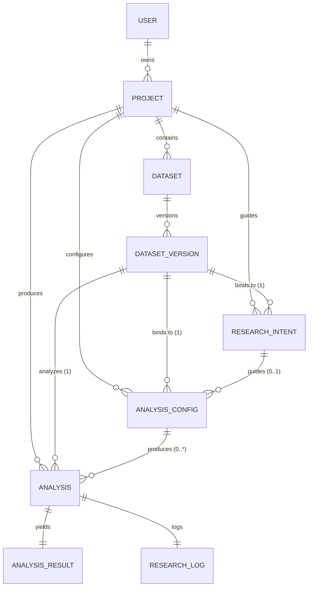
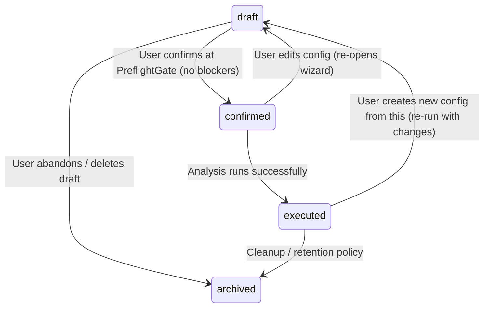

# Entity Relationships & Data Models — AR-02

> **Scope**: `AnalysisConfig`, `ResearchIntent`, `DatasetVersion` binding, extended `Analysis`
> **Format**: Mermaid ERD + field definitions + migration notes

---

## 1. Entity Relationship Diagram



### Cardinality Notes

| Relationship | Cardinality | Business Rule |
|--------------|-------------|---------------|
| Project → ResearchIntent | 1:N | Multiple research questions per project |
| Project → AnalysisConfig | 1:N | Multiple configs per project |
| DatasetVersion → ResearchIntent | 1:1 | Intent binds to **exact version** |
| DatasetVersion → AnalysisConfig | 1:N | Multiple configs on same version |
| ResearchIntent → AnalysisConfig | 1:N | One intent can spawn multiple config attempts |
| AnalysisConfig → Analysis | 1:N | Config can be re-run (rerun creates new Analysis) |
| Analysis → AnalysisResult | 1:1 | Immutable result payload |
| Analysis → ResearchLog | 1:1 | Audit trail entry |

---

## 2. ResearchIntent

### Purpose
Captures the **research goal** before method selection. Drives deterministic method recommender.

### Table Definition

```sql
CREATE TABLE research_intents (
    id UUID PRIMARY KEY DEFAULT gen_random_uuid(),
    project_id UUID NOT NULL REFERENCES projects(id) ON DELETE CASCADE,
    dataset_version_id UUID NOT NULL REFERENCES dataset_versions(id) ON DELETE CASCADE,
    goal_category VARCHAR(32) NOT NULL CHECK (goal_category IN (
        'compare_groups',
        'test_association',
        'predict_outcome',
        'explore_structure',
        'describe_data',
        'custom'
    )),
    design_hints JSONB NOT NULL DEFAULT '{}',
    user_question TEXT,
    created_at TIMESTAMPTZ NOT NULL DEFAULT NOW(),
    updated_at TIMESTAMPTZ NOT NULL DEFAULT NOW()
);

CREATE INDEX idx_research_intents_project ON research_intents(project_id);
CREATE INDEX idx_research_intents_version ON research_intents(dataset_version_id);
CREATE UNIQUE INDEX uq_research_intent_project_version ON research_intents(project_id, dataset_version_id)
    WHERE goal_category != 'custom';  -- Allow multiple 'custom' per version
```

### Field Details

| Field | Type | Nullable | Default | Description |
|-------|------|----------|---------|-------------|
| `id` | UUID | No | gen_random_uuid() | PK |
| `project_id` | UUID | No | — | Owner project |
| `dataset_version_id` | UUID | No | — | **Exact version binding** (not version number) |
| `goal_category` | Enum | No | — | 6 categories (see below) |
| `design_hints` | JSONB | No | `{}` | Structured design metadata |
| `user_question` | Text | Yes | NULL | Free-form question |
| `created_at` | Timestamptz | No | NOW() | Creation timestamp |
| `updated_at` | Timestamptz | No | NOW() | Auto-update via trigger |

### Goal Categories & Design Hints Schema

| Category | Description | Required `design_hints` Keys | Example |
|----------|-------------|------------------------------|---------|
| `compare_groups` | Compare means/medians across groups | `design` (between/within), `groups` (int), `paired` (bool), `outcome_type` | `{"design":"between_subjects","groups":2,"paired":false,"outcome_type":"continuous"}` |
| `test_association` | Test relationship between variables | `variable_types` (array), `directional` (bool) | `{"variable_types":["categorical","categorical"],"directional":false}` |
| `predict_outcome` | Predict outcome from predictors | `outcome_type`, `predictors` (roles) | `{"outcome_type":"binary","predictors":["continuous","categorical"]}` |
| `explore_structure` | Clustering, dimensionality reduction | `clusters_expected` (int), `method_preference` | `{"clusters_expected":3,"method_preference":"kmeans"}` |
| `describe_data` | Descriptive statistics only | None required | `{}` |
| `custom` | Free-form / manual override | None | `{}` |

### JSON Schema for `design_hints`

```json
{
  "type": "object",
  "properties": {
    "design": {"type": "string", "enum": ["between_subjects", "within_subjects", "mixed", "observational", "time_series"]},
    "groups": {"type": "integer", "minimum": 1},
    "paired": {"type": "boolean"},
    "outcome_type": {"type": "string", "enum": ["continuous", "binary", "ordinal", "nominal", "count", "time_to_event"]},
    "predictors": {"type": "array", "items": {"type": "string"}},
    "variable_types": {"type": "array", "items": {"type": "string"}},
    "directional": {"type": "boolean"},
    "clusters_expected": {"type": "integer", "minimum": 2},
    "topics_expected": {"type": "integer", "minimum": 2},
    "method_preference": {"type": "string"}
  },
  "additionalProperties": true
}
```

---

## 3. AnalysisConfig

### Purpose
**Immutable configuration snapshot** for an analysis run. Created by Guided wizard (Step 4) or Manual mode. Binds all decisions: dataset version, method, variables, params, preprocessing.

### Table Definition

```sql
CREATE TABLE analysis_configs (
    id UUID PRIMARY KEY DEFAULT gen_random_uuid(),
    project_id UUID NOT NULL REFERENCES projects(id) ON DELETE CASCADE,
    research_intent_id UUID REFERENCES research_intents(id) ON DELETE SET NULL,
    dataset_version_id UUID NOT NULL REFERENCES dataset_versions(id) ON DELETE CASCADE,
    method VARCHAR(32) NOT NULL,
    variables JSONB NOT NULL,
    params JSONB NOT NULL DEFAULT '{}',
    preprocessing_ops JSONB NOT NULL DEFAULT '[]',
    status VARCHAR(16) NOT NULL DEFAULT 'draft' CHECK (status IN ('draft','confirmed','executed','archived')),
    source_mode VARCHAR(8) NOT NULL CHECK (source_mode IN ('guided','manual')),
    wizard_step INT NOT NULL DEFAULT 0 CHECK (wizard_step BETWEEN 0 AND 5),
    preflight_result JSONB,
    created_at TIMESTAMPTZ NOT NULL DEFAULT NOW(),
    updated_at TIMESTAMPTZ NOT NULL DEFAULT NOW(),
    confirmed_at TIMESTAMPTZ,
    executed_at TIMESTAMPTZ
);

CREATE INDEX idx_analysis_configs_project ON analysis_configs(project_id);
CREATE INDEX idx_analysis_configs_intent ON analysis_configs(research_intent_id);
CREATE INDEX idx_analysis_configs_version ON analysis_configs(dataset_version_id);
CREATE INDEX idx_analysis_configs_status ON analysis_configs(status);
CREATE INDEX idx_analysis_configs_method ON analysis_configs(method);
```

### Field Details

| Field | Type | Nullable | Default | Description |
|-------|------|----------|---------|-------------|
| `id` | UUID | No | gen_random_uuid() | PK |
| `project_id` | UUID | No | — | Owner project |
| `research_intent_id` | UUID | Yes | NULL | Link to intent (Guided only) |
| `dataset_version_id` | UUID | No | — | **Exact version UUID** (replaces `ver` int) |
| `method` | String | No | — | Method ID from `METHOD_IDS` |
| `variables` | JSONB | No | — | Column mappings per method spec |
| `params` | JSONB | No | `{}` | Method parameters (alpha, mu, n_clusters, etc.) |
| `preprocessing_ops` | JSONB | No | `[]` | Ordered ops chain applied to base version |
| `status` | Enum | No | `draft` | `draft`→`confirmed`→`executed`→`archived` |
| `source_mode` | Enum | No | — | `guided` or `manual` |
| `wizard_step` | Int | No | 0 | Last completed step (1-5) for Guided resume |
| `preflight_result` | JSONB | Yes | NULL | Cached pre-flight v2 output at confirm |
| `created_at` | Timestamptz | No | NOW() | Creation |
| `updated_at` | Timestamptz | No | NOW() | Auto-update |
| `confirmed_at` | Timestamptz | Yes | NULL | When user confirmed at PreflightGate |
| `executed_at` | Timestamptz | Yes | NULL | When analysis actually ran |

### Status Transitions



### `variables` Schema (Per Method)

Stored as JSONB matching `METHOD_SPEC[method]["variables"]` keys:

```json
// Example: ttest_ind
{
  "column": "score",
  "group": "treatment"
}

// Example: linreg_multiple
{
  "xs": ["age", "income", "education"],
  "y": "satisfaction"
}

// Example: descriptive
{
  "columns": ["age", "income", "score"]
}
```

### `params` Schema (Per Method)

Includes `alpha` always + method-specific params:

```json
// Example: ttest_1samp
{
  "alpha": 0.05,
  "mu": 50.0
}

// Example: ml_cluster (Phase-2, hidden)
{
  "alpha": 0.05,
  "algorithm": "kmeans",
  "n_clusters": 3
}
```

### `preprocessing_ops` Schema

Ordered array of operations applied **before** analysis:

```json
[
  {"op": "drop_missing", "column": "income"},
  {"op": "scale_standard", "column": "score"},
  {"op": "remove_outlier_iqr", "column": "score", "params": {"multiplier": 1.5}}
]
```

Each op: `{op, column?, params?}`. Matches `OPS` in `ProjectView.tsx`.

---

## 4. Analysis (Extended)

### Existing Fields (Preserved)
| Field | Type | Notes |
|-------|------|-------|
| `id` | BigSerial | PK |
| `project_id` | UUID | FK |
| `dataset_version_id` | UUID | FK |
| `analysis_uid` | String | `ANL-YYYYMMDD-XXXXXX` |
| `method` | String | Method ID |
| `variables` | JSONB | Column mappings |
| `params` | JSONB | Method params |
| `status` | String | `pending`/`running`/`done`/`failed` |
| `created_at` | Timestamptz | |

### New Fields (AR-02)

```sql
ALTER TABLE analyses ADD COLUMN analysis_config_id UUID REFERENCES analysis_configs(id) ON DELETE SET NULL;
ALTER TABLE analyses ADD COLUMN analysis_hash CHAR(64) NOT NULL DEFAULT '';
```

| Field | Type | Nullable | Description |
|-------|------|----------|-------------|
| `analysis_config_id` | UUID | Yes | Link to config that produced this analysis |
| `analysis_hash` | CHAR(64) | No | **Extended hash** (see below) |

### Extended `analysis_hash` Coverage

```python
def analysis_hash_v2(context: dict, result: dict, config: AnalysisConfig) -> str:
    """
    Deterministic hash for exact reproducibility.
    Covers: context + result + preprocessing + engine + missing policy + random seeds
    """
    payload = {
        "context": {
            "method": context["method"],
            "variables": context["variables"],
            "params": context["params"],
            "dataset_version_id": str(context["dataset_version_id"]),
            "project_id": str(context["project_id"]),
            # NEW FIELDS:
            "preprocessing_config": config.preprocessing_ops,      # Ordered ops chain
            "engine_version": settings.software_version,           # e.g., "1.2.0"
            "missing_policy": config.params.get("missing_policy", "drop"),
            "random_seeds": extract_random_seeds(config.params),   # Any param ending in _seed or random_state
        },
        "result": result,
    }
    canon = json.dumps(payload, sort_keys=True, ensure_ascii=False, default=str)
    return hashlib.sha256(canon.encode("utf-8")).hexdigest()
```

**Impact**: Duplicate detection (`Analysis` dedup logic in `analyses.py`) now distinguishes:
- Same method/vars/params on **different preprocessed versions** → different hash
- Same config on **different engine versions** → different hash
- Same config with **different random seeds** → different hash

### Duplicate Detection Logic (Updated)

```python
# In analyses.py run()
prev = db.query(Analysis).filter(
    Analysis.project_id == body.project_id,
    Analysis.dataset_version_id == base.id,
    Analysis.method == body.method,
).order_by(Analysis.created_at.desc()).first()

if prev:
    # Compare extended hash via analysis_hash column
    new_hash = analysis_hash_v2(context, result, config)
    if prev.analysis_hash == new_hash:
        # Exact duplicate
        result.setdefault("notes", []).append(
            f"Identical analysis already exists ({prev.analysis_uid})"
        )
```

---

## 5. DatasetVersion Binding (Critical Fix)

### Problem (Pre-AR-02)
```python
# Existing RunIn uses ambiguous version number
class RunIn(BaseModel):
    project_id: UUID
    dataset_id: UUID
    base_version: int = 1  # Version NUMBER, not ID!
    method: str
    variables: dict
    params: dict
```
**Issue**: `base_version=2` means different datasets for different `dataset_id`. No foreign key integrity.

### Solution (AR-02)
All new endpoints use **`dataset_version_id` (UUID)**:

```python
# New: AnalysisConfig binds to exact DatasetVersion row
class AnalysisConfigCreate(BaseModel):
    project_id: UUID
    dataset_version_id: UUID  # Direct FK
    method: str
    variables: dict
    params: dict
    preprocessing_ops: list = []
    research_intent_id: UUID | None = None
```

### Migration Path

1. **Add column** `analysis_config_id` to `analyses`
2. **Add column** `analysis_hash` to `analyses` (CHAR(64))
3. **Create** `research_intents` table
4. **Create** `analysis_configs` table
5. **Backfill** existing `Analysis` rows:
   - Compute `analysis_hash_v2` for each (using empty preprocessing_ops, current engine_version)
   - Create `AnalysisConfig` row for each unique (project, dataset_version, method, variables, params)
   - Link `Analysis.analysis_config_id` to created config
6. **Deprecate** `base_version` in `RunIn` (keep for backward compat, but prefer `dataset_version_id`)

### Version Resolution Helper

```python
def resolve_dataset_version(
    db: Session,
    user: User,
    project_id: UUID,
    dataset_id: UUID | None = None,
    dataset_version_id: UUID | None = None,
    base_version: int | None = None,
) -> DatasetVersion:
    """
    Resolve to DatasetVersion using priority:
    1. dataset_version_id (explicit, preferred)
    2. dataset_id + base_version (legacy)
    3. dataset_id + latest version (default)
    """
    if dataset_version_id:
        dv = db.query(DatasetVersion).filter(
            DatasetVersion.id == dataset_version_id
        ).first()
        if not dv:
            raise NotFound("Dataset version not found")
        # Verify ownership via dataset -> project
        ds = db.query(Dataset).filter(Dataset.id == dv.dataset_id).first()
        if not ds or ds.project_id != project_id:
            raise Forbidden("Version not in project")
        return dv

    if dataset_id and base_version:
        # Legacy path
        dv = db.query(DatasetVersion).join(Dataset).filter(
            Dataset.id == dataset_id,
            Dataset.project_id == project_id,
            DatasetVersion.version_number == base_version
        ).first()
        if not dv:
            raise NotFound(f"Version v{base_version} not found")
        return dv

    # Default: latest version of first dataset in project
    # (used by guided wizard when user hasn't selected yet)
    ...
```

---

## 6. Pre-flight v2 Result Structure (Persisted in AnalysisConfig)

Stored in `AnalysisConfig.preflight_result` at confirm step:

```json
{
  "ok": false,
  "issues": [
    {
      "level": "blocking",
      "code": "MISSING_GROUP_COLUMN",
      "key": "group",
      "message": "Kolom pengelompok tidak dipilih",
      "fix": "Pilih kolom kategorikal dengan tepat 2 level untuk ttest_ind",
      "details": {"available_categorical": ["treatment", "gender", "site"]}
    },
    {
      "level": "confirmation",
      "code": "LOW_EXPECTED_FREQUENCY",
      "key": "col1",
      "message": "Beberapa sel harapan < 5 (chi-square assumption)",
      "fix": "Gabungkan kategori atau gunakan Fisher's exact (tidak tersedia)",
      "details": {"min_expected": 2.3, "cells_below_5": 3}
    },
    {
      "level": "warning",
      "code": "MA-03_GROUPS_GT_2",
      "key": "group",
      "message": "Terdeteksi >2 grup, pertimbangkan ANOVA",
      "fix": "Jika ingin bandingkan 2 grup, filter data. Atau ganti ke anova_oneway",
      "details": {"detected_groups": 4, "switch_to": "anova_oneway"}
    }
  ],
  "method_contract": {
    "assumptions": [
      {"name": "independence", "check": "Design (between-subjects)", "status": "unknown"},
      {"name": "normality", "check": "Shapiro-Wilk per group", "status": "unknown", "warning_if_failed": true},
      {"name": "homogeneity", "check": "Levene's test", "status": "unknown", "warning_if_failed": true, "fallback": "Welch's t-test"}
    ],
    "limitations": [
      {"description": "Not for paired data (use ttest_paired)"},
      {"description": "Sensitive to extreme outliers"}
    ],
    "alternatives": [
      {"condition": "normality violated", "switch_to": "mannwhitney", "reason": "Non-parametric"},
      {"condition": "variance heterogeneity", "switch_to": "ttest_ind (equal_var=false)", "reason": "Welch's t-test robust"}
    ]
  },
  "ma_rules_triggered": [
    {"rule": "MA-03", "message": ">2 groups detected", "switch_to": "anova_oneway"},
    {"rule": "MA-05", "message": "Outliers detected (IQR)", "switch_to": "mannwhitney"}
  ]
}
```

---

## 7. Migration Scripts

### 7.1 Alembic Migration (Conceptual)

```python
# migrations/versions/xxxx_ar02_entities.py
"""AR-02: ResearchIntent, AnalysisConfig, extended Analysis"""

from alembic import op
import sqlalchemy as sa
from sqlalchemy.dialects import postgresql

revision = 'xxxx_ar02_entities'
down_revision = 'previous_revision'
branch_labels = None
depends_on = None

def upgrade():
    # ResearchIntent
    op.create_table(
        'research_intents',
        sa.Column('id', postgresql.UUID(as_uuid=True), primary_key=True, server_default=sa.text('gen_random_uuid()')),
        sa.Column('project_id', postgresql.UUID(as_uuid=True), sa.ForeignKey('projects.id', ondelete='CASCADE'), nullable=False),
        sa.Column('dataset_version_id', postgresql.UUID(as_uuid=True), sa.ForeignKey('dataset_versions.id', ondelete='CASCADE'), nullable=False),
        sa.Column('goal_category', sa.String(32), nullable=False),
        sa.Column('design_hints', postgresql.JSONB, nullable=False, server_default='{}'),
        sa.Column('user_question', sa.Text, nullable=True),
        sa.Column('created_at', sa.DateTime(timezone=True), nullable=False, server_default=sa.func.now()),
        sa.Column('updated_at', sa.DateTime(timezone=True), nullable=False, server_default=sa.func.now()),
    )
    op.create_index('ix_research_intents_project', 'research_intents', ['project_id'])
    op.create_index('ix_research_intents_version', 'research_intents', ['dataset_version_id'])
    op.execute("""
        ALTER TABLE research_intents ADD CONSTRAINT chk_goal_category
        CHECK (goal_category IN ('compare_groups','test_association','predict_outcome','explore_structure','describe_data','custom'))
    """)

    # AnalysisConfig
    op.create_table(
        'analysis_configs',
        sa.Column('id', postgresql.UUID(as_uuid=True), primary_key=True, server_default=sa.text('gen_random_uuid()')),
        sa.Column('project_id', postgresql.UUID(as_uuid=True), sa.ForeignKey('projects.id', ondelete='CASCADE'), nullable=False),
        sa.Column('research_intent_id', postgresql.UUID(as_uuid=True), sa.ForeignKey('research_intents.id', ondelete='SET NULL'), nullable=True),
        sa.Column('dataset_version_id', postgresql.UUID(as_uuid=True), sa.ForeignKey('dataset_versions.id', ondelete='CASCADE'), nullable=False),
        sa.Column('method', sa.String(32), nullable=False),
        sa.Column('variables', postgresql.JSONB, nullable=False),
        sa.Column('params', postgresql.JSONB, nullable=False, server_default='{}'),
        sa.Column('preprocessing_ops', postgresql.JSONB, nullable=False, server_default='[]'),
        sa.Column('status', sa.String(16), nullable=False, server_default='draft'),
        sa.Column('source_mode', sa.String(8), nullable=False),
        sa.Column('wizard_step', sa.Integer, nullable=False, server_default='0'),
        sa.Column('preflight_result', postgresql.JSONB, nullable=True),
        sa.Column('created_at', sa.DateTime(timezone=True), nullable=False, server_default=sa.func.now()),
        sa.Column('updated_at', sa.DateTime(timezone=True), nullable=False, server_default=sa.func.now()),
        sa.Column('confirmed_at', sa.DateTime(timezone=True), nullable=True),
        sa.Column('executed_at', sa.DateTime(timezone=True), nullable=True),
    )
    op.create_index('ix_analysis_configs_project', 'analysis_configs', ['project_id'])
    op.create_index('ix_analysis_configs_intent', 'analysis_configs', ['research_intent_id'])
    op.create_index('ix_analysis_configs_version', 'analysis_configs', ['dataset_version_id'])
    op.create_index('ix_analysis_configs_status', 'analysis_configs', ['status'])
    op.execute("""
        ALTER TABLE analysis_configs ADD CONSTRAINT chk_status
        CHECK (status IN ('draft','confirmed','executed','archived'))
    """)
    op.execute("""
        ALTER TABLE analysis_configs ADD CONSTRAINT chk_source_mode
        CHECK (source_mode IN ('guided','manual'))
    """)
    op.execute("""
        ALTER TABLE analysis_configs ADD CONSTRAINT chk_wizard_step
        CHECK (wizard_step BETWEEN 0 AND 5)
    """)

    # Extend analyses
    op.add_column('analyses', sa.Column('analysis_config_id', postgresql.UUID(as_uuid=True), sa.ForeignKey('analysis_configs.id', ondelete='SET NULL'), nullable=True))
    op.add_column('analyses', sa.Column('analysis_hash', sa.String(64), nullable=False, server_default=''))
    op.create_index('ix_analyses_config', 'analyses', ['analysis_config_id'])

    # Trigger for updated_at
    op.execute("""
        CREATE OR REPLACE FUNCTION update_updated_at()
        RETURNS TRIGGER AS $$
        BEGIN
            NEW.updated_at = NOW();
            RETURN NEW;
        END;
        $$ LANGUAGE plpgsql;
    """)
    op.execute("CREATE TRIGGER trg_research_intents_updated BEFORE UPDATE ON research_intents FOR EACH ROW EXECUTE FUNCTION update_updated_at()")
    op.execute("CREATE TRIGGER trg_analysis_configs_updated BEFORE UPDATE ON analysis_configs FOR EACH ROW EXECUTE FUNCTION update_updated_at()")

def downgrade():
    op.drop_table('analysis_configs')
    op.drop_table('research_intents')
    op.drop_column('analyses', 'analysis_hash')
    op.drop_column('analyses', 'analysis_config_id')
```

### 7.2 Backfill Script (Python)

```python
# scripts/backfill_ar02_configs.py
"""Backfill AnalysisConfig for existing analyses"""

from app.core.db import SessionLocal
from app.models import Analysis, DatasetVersion, AnalysisConfig
from app.services.stats import analysis_hash as compute_hash
from app.core.config import settings
import json

db = SessionLocal()

try:
    # Group analyses by unique config signature
    configs_map = {}
    for analysis in db.query(Analysis).filter(Analysis.status == 'done').all():
        key = (
            analysis.project_id,
            analysis.dataset_version_id,
            analysis.method,
            json.dumps(analysis.variables, sort_keys=True),
            json.dumps(analysis.params or {}, sort_keys=True),
        )
        if key not in configs_map:
            configs_map[key] = []
        configs_map[key].append(analysis)

    for key, analyses in configs_map.items():
        project_id, dv_id, method, variables, params = key
        # Create config
        config = AnalysisConfig(
            project_id=project_id,
            dataset_version_id=dv_id,
            method=method,
            variables=json.loads(variables),
            params=json.loads(params),
            preprocessing_ops=[],
            status='executed',
            source_mode='manual',
            wizard_step=0,
            confirmed_at=analyses[0].created_at,
            executed_at=analyses[0].created_at,
        )
        db.add(config)
        db.flush()

        # Compute extended hash for each analysis
        dv = db.query(DatasetVersion).get(dv_id)
        for a in analyses:
            a.analysis_config_id = config.id
            # Recompute hash with extended coverage
            context = {
                "method": method,
                "variables": json.loads(variables),
                "params": json.loads(params),
                "dataset_version_id": dv_id,
                "project_id": project_id,
            }
            # Need result - fetch from AnalysisResult
            from app.models import AnalysisResult
            res = db.query(AnalysisResult).filter(AnalysisResult.analysis_id == a.id).first()
            if res:
                a.analysis_hash = compute_hash(context, res.result, config)

    db.commit()
    print(f"Backfilled {len(configs_map)} configs for {sum(len(v) for v in configs_map.values())} analyses")

finally:
    db.close()
```

---

## 8. API Payload Examples

### Create ResearchIntent (Guided Step 2)

```bash
POST /api/v1/research-intent
{
  "project_id": "a1b2c3d4-e5f6-7890-abcd-ef1234567890",
  "dataset_version_id": "b2c3d4e5-f6a7-8901-bcde-f23456789012",
  "goal_category": "compare_groups",
  "design_hints": {
    "design": "between_subjects",
    "groups": 2,
    "paired": false,
    "outcome_type": "continuous"
  },
  "user_question": "Apakah ada perbedaan rata-rata skor kepuasan antara grup perlakuan dan kontrol?"
}
```

### Method Recommendation Response

```json
{
  "recommendations": [
    {
      "method_id": "ttest_ind",
      "confidence": 0.95,
      "variable_mapping": {"group": "treatment", "column": "satisfaction_score"},
      "assumptions_check": {"normality": "unknown", "homogeneity": "unknown"},
      "warnings": ["Levene test requires SPSS for full validation"],
      "alternatives": ["mannwhitney"]
    },
    {
      "method_id": "mannwhitney",
      "confidence": 0.85,
      "variable_mapping": {"group": "treatment", "column": "satisfaction_score"},
      "assumptions_check": {},
      "warnings": ["Less power than t-test if assumptions met"],
      "alternatives": []
    }
  ],
  "fallback": "descriptive"
}
```

### Create AnalysisConfig (Guided Step 4)

```bash
POST /api/v1/analysis-config/guided
{
  "project_id": "a1b2c3d4-e5f6-7890-abcd-ef1234567890",
  "dataset_version_id": "b2c3d4e5-f6a7-8901-bcde-f23456789012",
  "method": "ttest_ind",
  "variables": {"column": "satisfaction_score", "group": "treatment"},
  "params": {"alpha": 0.05},
  "preprocessing_ops": [
    {"op": "drop_missing", "column": "satisfaction_score"}
  ],
  "research_intent_id": "c3d4e5f6-a7b8-9012-cdef-345678901234",
  "wizard_step": 4
}
```

### Config Confirm + Preflight

```bash
POST /api/v1/analysis-config/{config_id}/confirm
{
  "acknowledged_confirmations": ["LOW_EXPECTED_FREQUENCY"]
}
```

### Run Guided Analysis

```bash
POST /api/v1/analyses/run-guided
{
  "project_id": "a1b2c3d4-e5f6-7890-abcd-ef1234567890",
  "dataset_id": "d4e5f6a7-b8c9-0123-defg-456789012345",
  "method": "ttest_ind",
  "variables": {"column": "satisfaction_score", "group": "treatment"},
  "params": {"alpha": 0.05},
  "analysis_config_id": "e5f6a7b8-c9d0-1234-efgh-567890123456"
}
```

---

## 9. Index Summary

| Table | Index | Columns | Purpose |
|-------|-------|---------|---------|
| `research_intents` | `idx_research_intents_project` | `project_id` | List intents per project |
| `research_intents` | `idx_research_intents_version` | `dataset_version_id` | Find intent for version |
| `research_intents` | `uq_research_intent_project_version` | `project_id, dataset_version_id` | Unique intent per version (non-custom) |
| `analysis_configs` | `idx_analysis_configs_project` | `project_id` | List configs per project |
| `analysis_configs` | `idx_analysis_configs_intent` | `research_intent_id` | Configs from intent |
| `analysis_configs` | `idx_analysis_configs_version` | `dataset_version_id` | Configs on version |
| `analysis_configs` | `idx_analysis_configs_status` | `status` | Filter by status |
| `analysis_configs` | `idx_analysis_configs_method` | `method` | Filter by method |
| `analyses` | `ix_analyses_config` | `analysis_config_id` | Link analysis to config |

---

## 10. Validation Rules (Application Layer)

| Entity | Rule | Enforcement |
|--------|------|-------------|
| `ResearchIntent` | One non-custom intent per (project, dataset_version) | Unique partial index |
| `ResearchIntent` | `dataset_version_id` must belong to `project_id` | FK + app check |
| `AnalysisConfig` | `method` must be in `METHOD_IDS` (respects `FEATURE_PHASE2`) | App validation |
| `AnalysisConfig` | `variables` keys must match `METHOD_SPEC[method].variables` | App validation |
| `AnalysisConfig` | `dataset_version_id` must belong to `project_id` | FK + app check |
| `AnalysisConfig` | `status` transition: draft→confirmed→executed→archived | App state machine |
| `AnalysisConfig` | `wizard_step` 0-5, only for `source_mode=guided` | App validation |
| `Analysis` | `analysis_hash` computed with extended coverage | Backend on create |
| `Analysis` | If `analysis_config_id` set, config must be `confirmed` or `executed` | App validation |