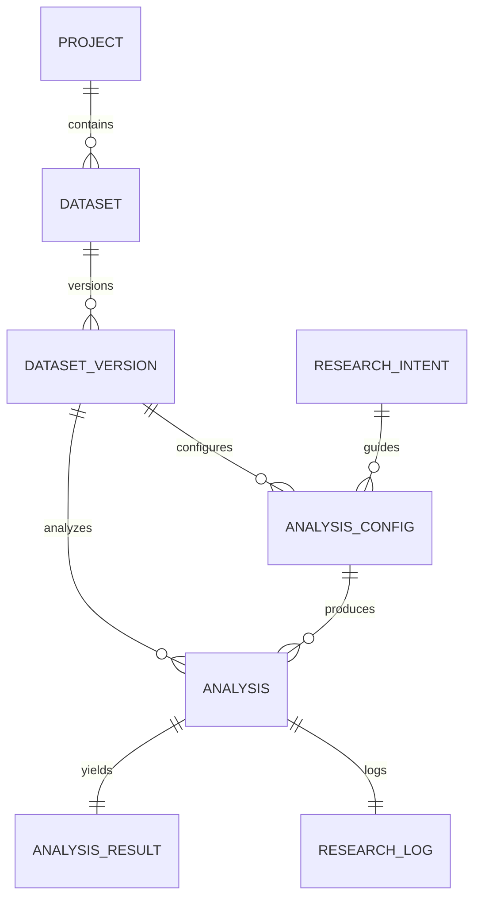
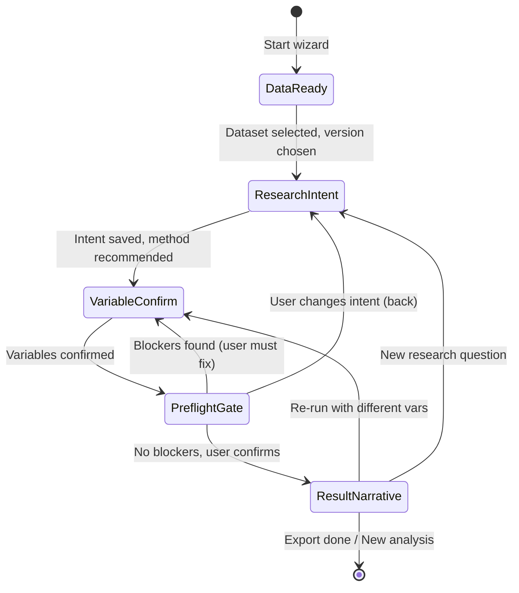

# AR-02 Dual-Mode Architecture Specification

> **Status**: DRAFT v1.0 — Source of truth untuk implementasi Mode Terpandu (Guided) & Manual
> **Scope**: Kontrak API, State Machine, Entity Relations, Integrasi Dual-Mode
> **Dependencies**: `METHOD_READINESS_MATRIX.md` (AR-01), existing `analyses.py`, `stats/__init__.py`, `ProjectView.tsx`

---

## 1. High-Level Architecture

```
┌─────────────────────────────────────────────────────────────────────────────┐
│                            DUAL-MODE ENTRY POINT                              │
│  ┌─────────────────────┐              ┌─────────────────────────────────┐   │
│  │   GUIDED WIZARD     │              │        MANUAL MODE              │   │
│  │  (5-step state      │              │  (Existing ProjectView tabs)    │   │
│  │   machine)          │              │  + Mode Switcher                │   │
│  └──────────┬──────────┘              └──────────────┬────────────────┘   │
│             │                                        │                     │
│             ▼                                        ▼                     │
│  ┌─────────────────────────────────────────────────────────────────────┐   │
│  │                    SHARED BACKEND SERVICES                          │   │
│  │  ┌──────────────┐ ┌──────────────┐ ┌──────────────┐ ┌────────────┐  │   │
│  │  │ResearchIntent│ │MethodRecommnd│ │ AnalysisCfg  │ │ Preflight  │  │   │
│  │  │   Service    │ │    Engine    │ │   Service    │ │    v2      │  │   │
│  │  └──────────────┘ └──────────────┘ └──────────────┘ └────────────┘  │   │
│  └────────────────────────────┬────────────────────────────────────────┘   │
│                               │                                            │
│                               ▼                                            │
│  ┌─────────────────────────────────────────────────────────────────────┐   │
│  │              SINGLE STATISTICAL ENGINE (run_analysis)               │   │
│  │  descriptive | normality | pearson | spearman | ttest_* | anova    │   │
│  │  chi2_* | mannwhitney | wilcoxon | kruskal | linreg_*              │   │
│  │  [Phase-2 hidden: ml_classify, ml_cluster, text_tfidf, text_lda,   │   │
│  │   apriori — feature flag FEATURE_PHASE2=false]                      │   │
│  └────────────────────────────┬────────────────────────────────────────┘   │
│                               │                                            │
│                               ▼                                            │
│  ┌─────────────────────────────────────────────────────────────────────┐   │
│  │                    PERSISTENCE LAYER                                │   │
│  │  AnalysisConfig ◄── ResearchIntent ◄── DatasetVersion ──► Analysis │   │
│  └─────────────────────────────────────────────────────────────────────┘   │
└─────────────────────────────────────────────────────────────────────────────┘
```

**Key Principle**: Satu mesin statistik (`run_analysis`) dipakai kedua mode. Perbedaan hanya di **bagaimana config dibangun** (wizard vs manual form), bukan di eksekusi.

---

## 2. Entity Relations (ERD)

### 2.1 Core Entities



### 2.2 New Entities for AR-02

#### `ResearchIntent`
| Field | Type | Constraints | Description |
|-------|------|-------------|-------------|
| `id` | UUID | PK | Primary key |
| `project_id` | UUID | FK→Project, Not Null | Owning project |
| `dataset_version_id` | UUID | FK→DatasetVersion, Not Null | Bound dataset version |
| `goal_category` | Enum | Not Null | `compare_groups`, `test_association`, `predict_outcome`, `explore_structure`, `describe_data`, `custom` |
| `design_hints` | JSONB | Default `{}` | Structured hints: `{"design": "between_subjects", "groups": 2, "paired": false, "outcome_type": "continuous"}` |
| `user_question` | Text | Nullable | Free-text research question dari user |
| `created_at` | DateTime | Default now() | Timestamp |
| `updated_at` | DateTime | On update | Timestamp |

#### `AnalysisConfig`
| Field | Type | Constraints | Description |
|-------|------|-------------|-------------|
| `id` | UUID | PK | Primary key |
| `project_id` | UUID | FK→Project, Not Null | Owning project |
| `research_intent_id` | UUID | FK→ResearchIntent, Nullable | Optional link to intent |
| `dataset_version_id` | UUID | FK→DatasetVersion, Not Null | **Explicit version binding** (replaces `ver` int) |
| `method` | String | Not Null, ∈ METHOD_IDS | Selected method ID |
| `variables` | JSONB | Not Null | Column mappings per method spec |
| `params` | JSONB | Default `{}` | Method parameters (alpha, mu, n_clusters, etc.) |
| `preprocessing_ops` | JSONB | Default `[]` | Ordered list of preprocessing ops applied to base version |
| `status` | Enum | Default `draft` | `draft`, `confirmed`, `executed`, `archived` |
| `source_mode` | Enum | Not Null | `guided`, `manual` |
| `wizard_step` | Int | Default 0 | Last completed wizard step (1-5) for resume |
| `preflight_result` | JSONB | Nullable | Cached pre-flight v2 output |
| `created_at` | DateTime | Default now() | Timestamp |
| `updated_at` | DateTime | On update | Timestamp |
| `confirmed_at` | DateTime | Nullable | When user confirmed at PreflightGate |
| `executed_at` | DateTime | Nullable | When analysis actually ran |

#### Extended `Analysis` (existing, added fields)
| Field | Type | Constraints | Description |
|-------|------|-------------|-------------|
| `analysis_config_id` | UUID | FK→AnalysisConfig, Nullable | Link to config that produced this analysis |
| `analysis_hash` | String(64) | Not Null | **Extended hash** covering preprocessing, engine_version, missing_policy, random_seeds |

### 2.3 DatasetVersion Binding (Critical)

**Problem**: Existing code uses `base_version: int` (version number) which is ambiguous across datasets.
**Solution**: `AnalysisConfig.dataset_version_id` (UUID) binds to exact `DatasetVersion` row.

```python
# Migration: analyses table
ALTER TABLE analyses ADD COLUMN analysis_config_id UUID REFERENCES analysis_configs(id);
ALTER TABLE analyses ADD COLUMN analysis_hash CHAR(64) NOT NULL DEFAULT '';

# New tables
CREATE TABLE research_intents (
    id UUID PRIMARY KEY DEFAULT gen_random_uuid(),
    project_id UUID NOT NULL REFERENCES projects(id) ON DELETE CASCADE,
    dataset_version_id UUID NOT NULL REFERENCES dataset_versions(id) ON DELETE CASCADE,
    goal_category VARCHAR(32) NOT NULL CHECK (goal_category IN (
        'compare_groups', 'test_association', 'predict_outcome',
        'explore_structure', 'describe_data', 'custom'
    )),
    design_hints JSONB NOT NULL DEFAULT '{}',
    user_question TEXT,
    created_at TIMESTAMPTZ NOT NULL DEFAULT NOW(),
    updated_at TIMESTAMPTZ NOT NULL DEFAULT NOW()
);

CREATE TABLE analysis_configs (
    id UUID PRIMARY KEY DEFAULT gen_random_uuid(),
    project_id UUID NOT NULL REFERENCES projects(id) ON DELETE CASCADE,
    research_intent_id UUID REFERENCES research_intents(id) ON DELETE SET NULL,
    dataset_version_id UUID NOT NULL REFERENCES dataset_versions(id) ON DELETE CASCADE,
    method VARCHAR(32) NOT NULL,
    variables JSONB NOT NULL,
    params JSONB NOT NULL DEFAULT '{}',
    preprocessing_ops JSONB NOT NULL DEFAULT '[]',
    status VARCHAR(16) NOT NULL DEFAULT 'draft' CHECK (status IN ('draft','confirmed','executed','archived')),
    source_mode VARCHAR(8) NOT NULL CHECK (source_mode IN ('guided','manual')),
    wizard_step INT NOT NULL DEFAULT 0 CHECK (wizard_step BETWEEN 0 AND 5),
    preflight_result JSONB,
    created_at TIMESTAMPTZ NOT NULL DEFAULT NOW(),
    updated_at TIMESTAMPTZ NOT NULL DEFAULT NOW(),
    confirmed_at TIMESTAMPTZ,
    executed_at TIMESTAMPTZ
);

CREATE INDEX idx_analysis_configs_project ON analysis_configs(project_id);
CREATE INDEX idx_analysis_configs_intent ON analysis_configs(research_intent_id);
CREATE INDEX idx_analysis_configs_version ON analysis_configs(dataset_version_id);
CREATE INDEX idx_research_intents_project ON research_intents(project_id);
```

---

## 3. Guided Wizard State Machine

### 3.1 States & Transitions



### 3.2 Step Definitions

| Step | Key | Title | Description | Completion Criteria | API Calls |
|------|-----|-------|-------------|---------------------|-----------|
| 1 | `DataReady` | Data Siap | Ringkasan dataset, versi aktif, kualitas data (missing, duplikat, tipe) | User selects dataset + version | `GET /datasets/{id}`, `GET /datasets/{id}/profile?version={v}` |
| 2 | `ResearchIntent` | Tujuan Penelitian | Pilih kategori tujuan / tulis pertanyaan → sistem rekomendasikan metode | Intent saved, method recommended | `POST /research-intent`, `POST /methods/recommend` |
| 3 | `VariableConfirm` | Konfirmasi Variabel | Sistem sarankan mapping kolom → user konfirmasi/ubah | Variables + params validated | `GET /methods/{id}` (spec), client-side validation |
| 4 | `PreflightGate` | Gerbang Pre-flight | Jalankan pre-flight v2 → tampilkan Blokir/Konfirmasi/Peringatan | No blockers, user confirms | `POST /analysis-config/guided` (save), `POST /analysis-config/{id}/confirm` (preflight) |
| 5 | `ResultNarrative` | Narasi Hasil | Hasil terstruktur 7 sections, ekspor 6 format, audit trail | User exports or starts new | `POST /analyses/run-guided`, `GET /analyses/{uid}` |

### 3.3 State Persistence

| Layer | Mechanism | Scope |
|-------|-----------|-------|
| **Client (draft)** | `localStorage` key `guided_wizard:{project_id}` | Survives refresh, tab close; cleared on `executed` or explicit reset |
| **Server (confirmed)** | `AnalysisConfig` row with `status=confirmed` | Persists across devices, enables resume, audit trail |
| **Transition** | Client → Server at **Step 4 confirm** | Draft becomes confirmed config; `wizard_step=4` |

```typescript
// localStorage schema
interface WizardDraft {
  projectId: string;
  datasetId: string;
  datasetVersionId: string;  // UUID, not version number
  currentStep: 1 | 2 | 3 | 4 | 5;
  researchIntent: ResearchIntentPayload | null;
  recommendedMethod: string | null;
  variables: Record<string, string | string[]>;
  params: Record<string, unknown>;
  preflightIssues: PreflightIssue[];
  updatedAt: string; // ISO
}
```

---

## 4. Pre-flight v2 (Unified for Guided & Manual)

### 4.1 Contract

**Input**: `dataset_version_id`, `method`, `variables`, `params`, `preprocessing_ops` (optional, for config-aware preflight)

**Output**:
```json
{
  "ok": boolean,
  "issues": [
    {
      "level": "blocking" | "confirmation" | "warning",
      "code": "string",           // Machine-readable code (e.g., "MISSING_GROUP_COLUMN")
      "key": "string",            // Field key related (e.g., "group", "column")
      "message": "string",        // Human-readable
      "fix": "string",            // Suggested action
      "details": {}               // Optional structured data
    }
  ],
  "method_contract": {            // Subset from METHOD_CONTRACTS
    "assumptions": [...],
    "limitations": [...],
    "alternatives": [...]
  },
  "ma_rules_triggered": [         // Matriks Advice rules MA-01..MA-06
    {"rule": "MA-03", "message": "...", "switch_to": "anova_oneway"}
  ]
}
```

### 4.2 Level Semantics

| Level | UI Treatment | Blocks Execution? |
|-------|--------------|-------------------|
| `blocking` | Red error, disable Run button | **Yes** (422 on run) |
| `confirmation` | Yellow dialog, requires explicit "Lanjutkan" | No (but must acknowledge) |
| `warning` | Yellow toast/badge, informational | No |

### 4.3 Integration Points

- **Guided**: Called at Step 4 (PreflightGate), result cached in `AnalysisConfig.preflight_result`
- **Manual**: Called on every form change in Analysis tab (existing `preflight_endpoint` enhanced)
- **Run endpoint**: Re-runs preflight internally, rejects on `blocking` (422)

### 4.4 MA Rules Integration

All 6 MA rules (MA-01..MA-06) evaluated in pre-flight v2, returned as `ma_rules_triggered`. Each rule maps to `level: "warning"` with `switch_to` suggestion where applicable.

---

## 5. Method Recommender (Deterministic Rules)

### 5.1 Input
- `ResearchIntent` (goal_category, design_hints)
- `DatasetProfile` (columns, types, missing, unique counts, n_rows)

### 5.2 Logic Source
**Method Contracts** (`docs/method-contracts/*.yaml`) — each contract declares:
- `research_designs` (e.g., `["between_subjects", "two_groups"]`)
- `required_variables` with roles, types, level constraints
- `assumptions` with checks

### 5.3 Algorithm (Pseudocode)

```python
def recommend_methods(intent: ResearchIntent, profile: DatasetProfile) -> List[Recommendation]:
    candidates = []
    for method_id in METHOD_IDS_MVP:  # Excludes Phase-2
        contract = load_contract(method_id)
        
        # 1. Design match
        if not design_matches(intent.design_hints, contract.research_designs):
            continue
            
        # 2. Variable feasibility
        vars_ok, mapping = check_variables(profile, contract.required_variables)
        if not vars_ok:
            continue
            
        # 3. Assumption pre-check (lightweight, no full preflight)
        assumptions_ok = quick_assumption_check(profile, mapping, contract.assumptions)
        
        # 4. Score
        score = calculate_score(contract, mapping, assumptions_ok, intent)
        candidates.append(Recommendation(method_id, mapping, score, assumptions_ok))
    
    return sorted(candidates, key=lambda r: r.score, reverse=True)[:3]
```

### 5.4 Output
```json
{
  "recommendations": [
    {
      "method_id": "ttest_ind",
      "confidence": 0.92,
      "variable_mapping": {"group": "treatment", "column": "score"},
      "assumptions_check": {"normality": "unknown", "homogeneity": "unknown"},
      "warnings": ["Levene test requires SPSS for full validation"],
      "alternatives": ["mannwhitney"]
    }
  ],
  "fallback": "descriptive"
}
```

---

## 6. Analysis Hash Coverage (Extended)

### 6.1 Current (Insufficient)
```python
# Existing analysis_hash(context, result) covers:
# - method, variables, params, dataset_version_id, project_id
# - result payload
```

### 6.2 Required Extended Coverage
```python
def analysis_hash_v2(context: dict, result: dict, config: AnalysisConfig) -> str:
    payload = {
        "context": {
            "method": context["method"],
            "variables": context["variables"],
            "params": context["params"],
            "dataset_version_id": context["dataset_version_id"],
            "project_id": context["project_id"],
            # NEW fields:
            "preprocessing_config": config.preprocessing_ops,      # Ordered ops chain
            "engine_version": settings.software_version,           # e.g., "1.2.0"
            "missing_policy": config.params.get("missing_policy", "drop"),  # New param
            "random_seeds": extract_random_seeds(config.params),   # For ML/bootstrapping
        },
        "result": result,
    }
    return sha256(canonical_json(payload))
```

**Impact**: Duplicate detection now catches same config on differently preprocessed data.

---

## 7. Feature Flag: Phase-2 Methods Hidden

### 7.1 Configuration
```python
# backend/app/core/config.py
class Settings(BaseSettings):
    FEATURE_PHASE2: bool = False  # Default false for beta
    # ...
```

### 7.2 Enforcement Points
| Location | Check |
|----------|-------|
| `METHOD_IDS` list (stats/__init__.py) | Filter at import: `[m for m in ALL_METHODS if m not in PHASE2 or settings.FEATURE_PHASE2]` |
| `GET /methods/{id}` | 404 if Phase-2 and flag off |
| `POST /methods/recommend` | Never returns Phase-2 |
| Frontend `METHODS` array | Filter at build/render time |
| `ProjectView.tsx` | `METHODS` constant filtered |

### 7.3 Phase-2 Method IDs
`ml_classify`, `ml_cluster`, `text_tfidf`, `text_lda`, `apriori`

---

## 8. Dual-Mode Integration Patterns

### 8.1 Guided → Manual Migration
When user switches **Guided → Manual** at any step:
- Current `AnalysisConfig` (draft or confirmed) becomes initial state for Manual tabs
- `variables`, `params`, `preprocessing_ops` pre-fill Manual forms
- `ResearchIntent` preserved as reference (read-only in Manual)
- Wizard `localStorage` cleared

### 8.2 Manual → Guided Reset
When user switches **Manual → Guided**:
- Wizard resets to Step 1 (DataReady)
- **But**: Analysis history (`Analysis` rows) preserved
- User can re-enter Guided flow fresh
- Previous Manual configs not auto-loaded (intentional — Guided is opinionated)

### 8.3 Shared Validation
| Validation | Guided | Manual |
|------------|--------|--------|
| Variable type compatibility | Step 3 + Preflight | On change + Preflight |
| Parameter ranges | Step 3 + Preflight | On change + Preflight |
| Pre-flight v2 | Step 4 (mandatory confirm) | On change (live), Run (mandatory) |
| MA rules | Step 4 display | Preflight panel display |

---

## 9. API Contracts Summary (New Endpoints)

| Method | Path | Purpose | Auth | Rate Limit |
|--------|------|---------|------|------------|
| POST | `/api/v1/research-intent` | Create/update research intent | Bearer | 60/min |
| GET | `/api/v1/research-intent/{id}` | Get intent | Bearer | 120/min |
| POST | `/api/v1/methods/recommend` | Get method recommendations | Bearer | 30/min |
| POST | `/api/v1/analysis-config/guided` | Create config from guided flow | Bearer | 30/min |
| GET | `/api/v1/analysis-config/{id}` | Get config for review | Bearer | 120/min |
| POST | `/api/v1/analysis-config/{id}/confirm` | Confirm config, run preflight v2 | Bearer | 30/min |
| POST | `/api/v1/analyses/run-guided` | Execute from confirmed config | Bearer | 30/min |

> **Full OpenAPI spec**: See `API_CONTRACTS/openapi.yaml`

---

## 10. Frontend Component Architecture (Guided)

```
GuidedWizard (Provider + State Machine)
├── StepNavGuided (extends StepNav, 5 steps, guided statuses)
├── DataReadyScreen
│   ├── DatasetSummaryCard
│   ├── VersionSelector
│   └── QualityIndicators (missing%, duplicates, type distribution)
├── ResearchIntentScreen
│   ├── GoalCategoryPicker (6 categories)
│   ├── DesignHintsForm (dynamic per category)
│   ├── FreeTextQuestion (optional)
│   └── MethodRecommendationCard (calls /methods/recommend)
├── VariableConfirmScreen
│   ├── VariablePicker (reuse existing component)
│   ├── ParamEditor (reuse existing, per method spec)
│   └── MappingReviewTable
├── PreflightGateScreen
│   ├── IssueList (grouped by level: blocking/confirmation/warning)
│   ├── MA_RulesPanel
│   ├── AssumptionChecklist
│   └── ConfirmButton (enabled only if no blockers + confirmations acknowledged)
└── ResultNarrativeScreen
    ├── ResultRenderer (per-method, 7 sections)
    ├── ExportToolbar (6 formats)
    ├── AuditTrailPanel (analysis_hash, config, preflight)
    └── ActionBar (New Analysis, Switch to Manual, Share)
```

---

## 11. Security & Authorization

- All new endpoints require `get_current_user` (Bearer token)
- Project ownership checked via `Project.user_id == user.id`
- DatasetVersion access verified via `Dataset.project_id == Project.id`
- `AnalysisConfig` scoped to project — no cross-project access
- Rate limits: 30/min for mutating endpoints, 120/min for reads

---

## 12. Migration Strategy

1. **DB Migration**: Add `research_intents`, `analysis_configs` tables + `analysis_config_id`, `analysis_hash` columns to `analyses`
2. **Backend**: Deploy new endpoints behind feature flag `FEATURE_GUIDED_MODE`
3. **Frontend**: Add GuidedWizard behind same flag, ModeSwitcher in ProjectView header
4. **Data Backfill**: Existing `Analysis` rows get `analysis_hash` recomputed on next read (lazy) or via migration script
5. **Rollout**: Enable flag for internal testing → limited beta → GA

---

## 13. Acceptance Criteria (Architecture Level)

| ID | Criterion | Verification |
|----|-----------|--------------|
| AC-01 | Single `run_analysis` serves both modes | Code review: no mode branching in stats engine |
| AC-02 | `AnalysisConfig.dataset_version_id` is UUID (not version number) | Migration + integration test |
| AC-03 | `analysis_hash` includes preprocessing, engine_version, missing_policy, random_seeds | Unit test with varied inputs |
| AC-04 | Pre-flight v2 returns {blockers, confirmations, warnings} for both modes | Contract test on endpoint |
| AC-05 | Method recommender uses METHOD_CONTRACTS as rule source | Unit test with contract fixtures |
| AC-06 | Phase-2 methods hidden when `FEATURE_PHASE2=false` | E2E test: API 404, UI absent |
| AC-07 | Guided wizard 5 steps enforce order, persist draft | E2E test: refresh at step 3 → resume |
| AC-08 | Guided→Manual carries config; Manual→Guided resets wizard | E2E test both directions |
| AC-09 | Result narrative 7 sections rendered per method | Visual regression + content test |
| AC-10 | Audit trail shows config, preflight, hash, software version | `GET /analyses/{uid}` includes all |

---

## 14. Open Questions / Decisions Needed

| # | Question | Options | Decision |
|---|----------|---------|----------|
| 1 | `missing_policy` param: global or per-method? | Global (simpler) vs per-method (flexible) | **Global** — add to `params` schema |
| 2 | `random_seeds` extraction: which params? | All `seed`, `random_state`, `n_bootstrap` | **Convention**: any param ending in `_seed` or `random_state` |
| 3 | Preflight v2 caching: TTL? | None (recompute) vs 5 min | **None** — preflight is fast, data may change |
| 4 | Wizard draft TTL in localStorage? | 7 days vs 30 days | **7 days** — aligns with session |
| 5 | `goal_category` "custom" — allow free-form method? | Yes (manual override) vs No (strict) | **Yes** — falls back to Manual mode equivalence |

---

## 15. Appendix: Method Contract Schema (Reference)

See `docs/method-contracts/*.yaml` (managed by `docs-keeper` agent). Each contract drives:
- Method recommender rules
- VariableConfirm screen mapping
- Pre-flight assumption checks
- Result narrative sections
- Export appendix content